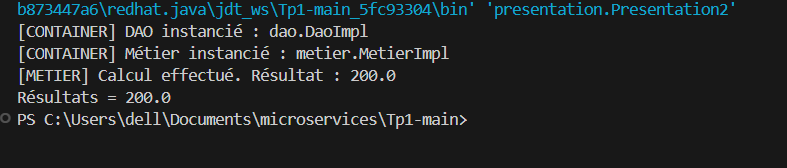
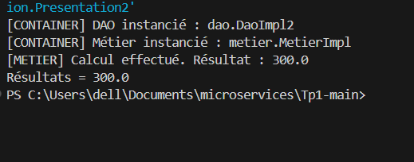

# TP1 : Inversion de Contrôle et Injection des Dépendances

Ce projet illustre les principes de **l'inversion de contrôle (IoC)** et de **l'injection des dépendances (DI)** en Java, démontrant le couplage faible entre la couche d'accès aux données (DAO) et la couche métier (Métier).

---

## 1. Architecture du Projet

- **Couche DAO** :
  - `IDao` : Interface définissant la méthode `double getValue()`.
  - `DaoImpl` : Première implémentation renvoyant `100.0`.
  - `DaoImpl2` : Nouvelle implémentation renvoyant `150.0`.
- **Couche Métier** :
  - `IMetier` : Interface définissant la méthode `double calcul()`.
  - `MetierImpl` : Implémentation du métier effectuant un calcul basé sur le DAO (`dao.getValue() * 2`).
- **Configuration & Présentation** :
  - `config.txt` : Fichier de configuration spécifiant dynamiquement les classes à instancier.
  - `Presentation2` : Application qui lit `config.txt`, instancie dynamiquement les classes via la réflexion (`Class.forName`), et injecte la dépendance DAO dans le Métier sans modifier le code source.

---

## 2. Résultats d'Exécution

### Exécution 1 : Avec l'implémentation `DaoImpl`

**Description :**
- Le fichier `config.txt` est configuré avec la classe `dao.DaoImpl`.
- Le conteneur instancie dynamiquement `dao.DaoImpl` via réflexion.
- `DaoImpl.getValue()` renvoie la valeur de base `100.0`.
- La dépendance est injectée dans `MetierImpl` par invocation du setter `setDao`.
- Le calcul métier (`100.0 * 2`) produit le résultat final : **`200.0`**.

---

### Exécution 2 : Avec la nouvelle implémentation `DaoImpl2`

**Description :**
- Le fichier `config.txt` est modifié pour référencer la nouvelle classe `dao.DaoImpl2` (`dao.DaoImpl2` à la place de `dao.DaoImpl`).
- **Aucune ligne de code Java n'a été modifiée**, illustrant le respect du principe Ouvert/Fermé (Open/Closed Principle) et le couplage faible.
- Le conteneur instancie dynamiquement `dao.DaoImpl2`.
- `DaoImpl2.getValue()` renvoie la nouvelle valeur `150.0`.
- Après injection dans `MetierImpl`, le calcul (`150.0 * 2`) produit le résultat final : **`300.0`**.